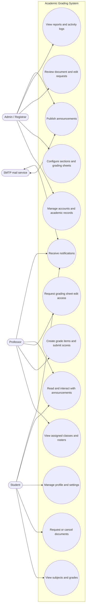
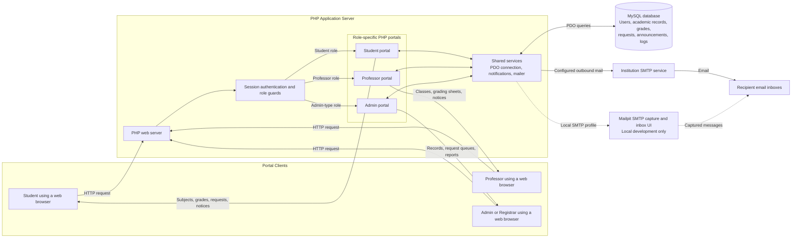
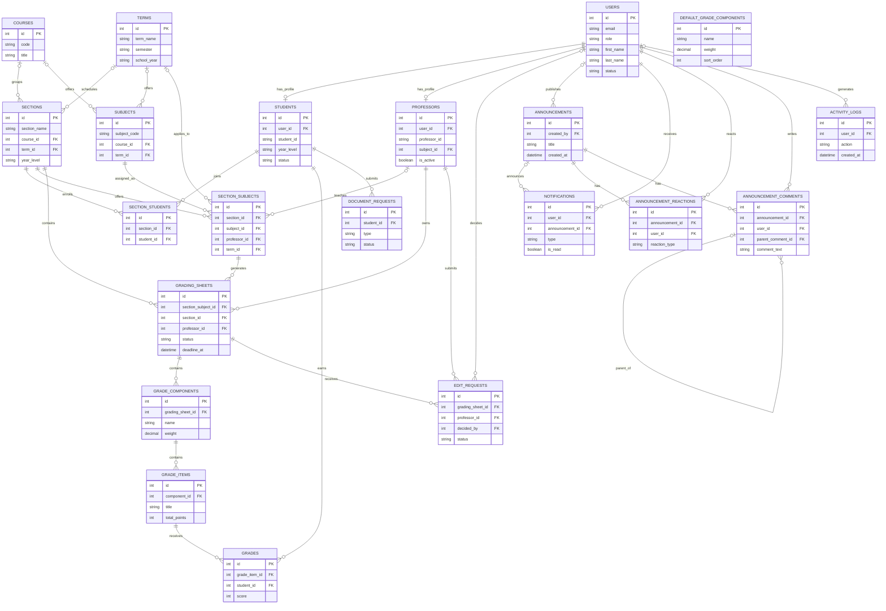
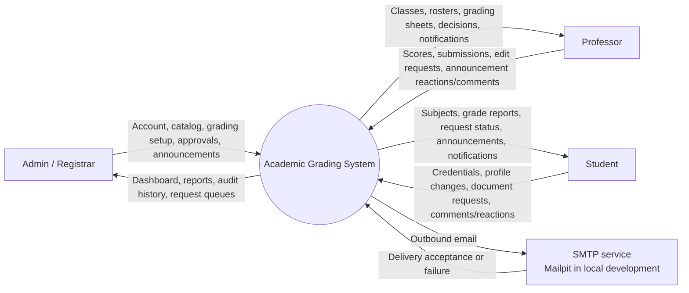
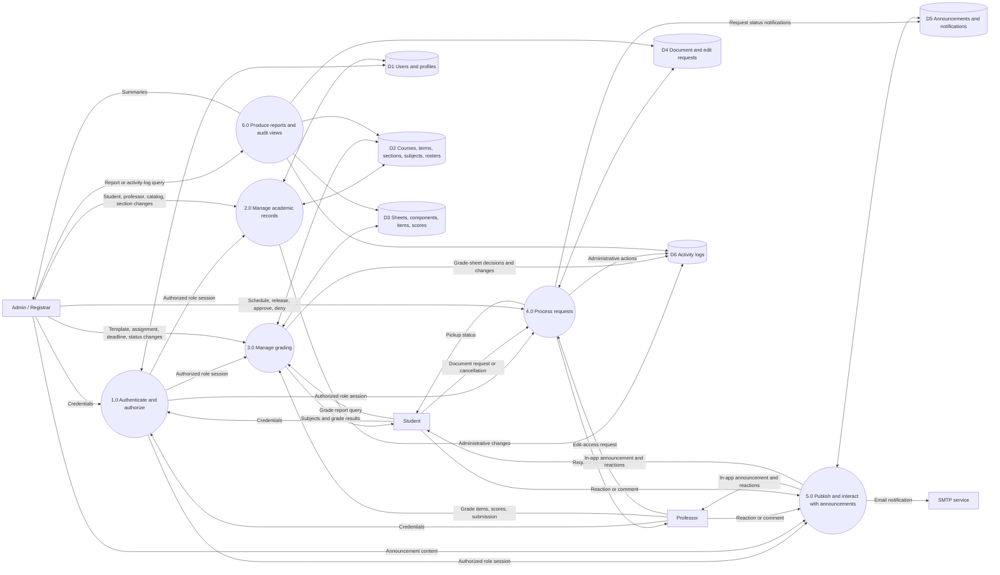
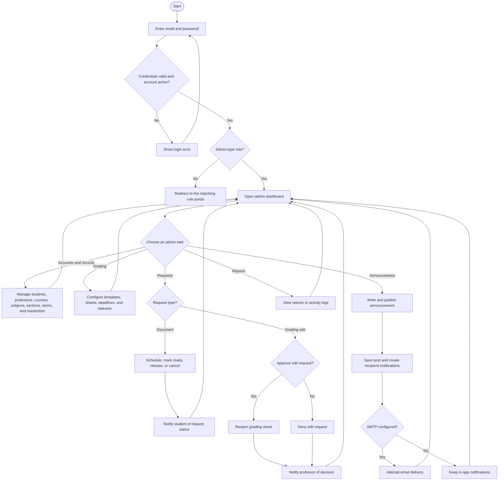
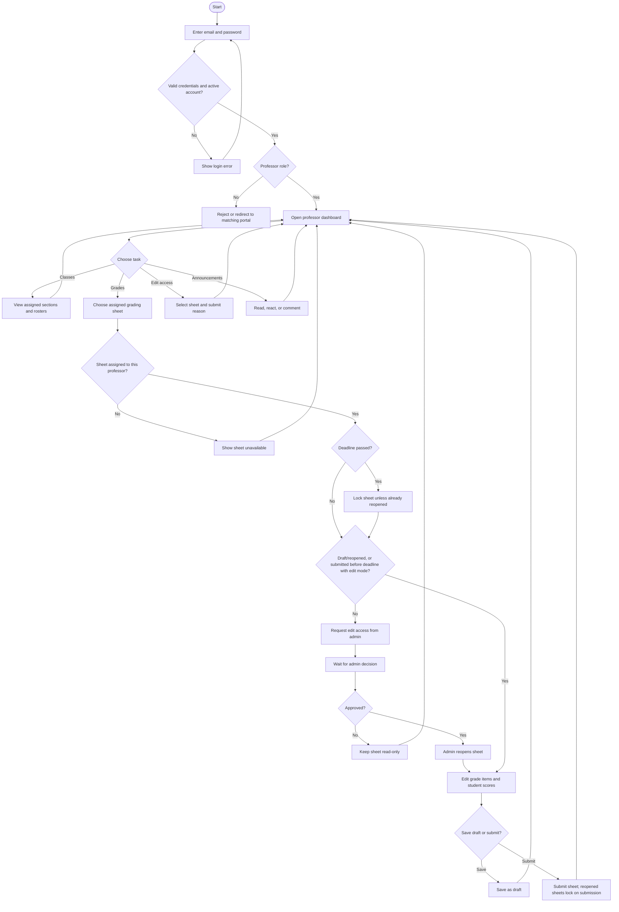
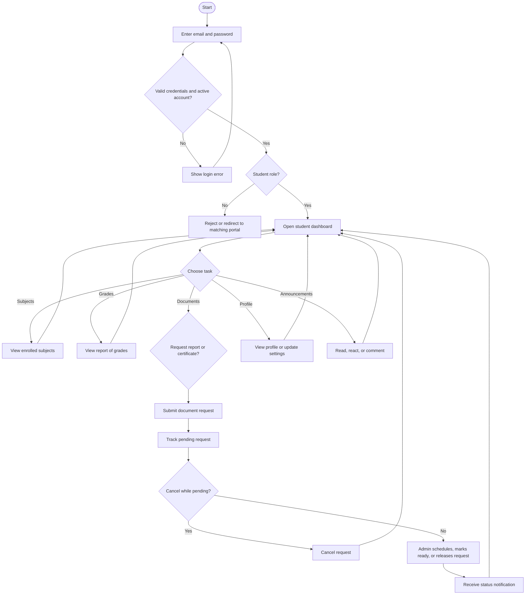

# Academic Grading System Diagrams

These diagrams describe the current PHP application, role guards, and checked-in MySQL schema. Mermaid blocks can be rendered in compatible Markdown previews.

## UML Use-Case View

## System Architecture View

The role portals access MySQL through shared PHP services; client browsers do not connect directly to the database. In local development, the mail launcher uses loopback-only Mailpit instead of delivering messages to real inboxes.

## ERD

The relationships below reflect foreign keys where defined and application joins where the schema stores IDs without declaring foreign-key constraints.

`DEFAULT_GRADE_COMPONENTS` is a reusable template copied into sheet-specific `GRADE_COMPONENTS`; it is not directly linked to a grading sheet. Some ID relationships shown above are enforced by application queries rather than database constraints.

## DFD Level 0

## DFD Level 1

## Admin Flowchart

## Professor Flowchart

## Student Flowchart

## Notes

- Login validates the password and blocks inactive accounts before redirecting by role.
- Grading-sheet statuses in the schema are `draft`, `submitted`, `locked`, and `reopened`; deadlines can lock sheets, and an approved professor edit request reopens one.
- Document-request statuses are `pending`, `scheduled`, `ready`, `released`, and `cancelled`. Professor edit-request statuses are `pending`, `approved`, and `denied`.
- The role guard accepts `mis` and `super_admin`, while the checked-in `users.role` enum lists `admin`, `registrar`, `professor`, and `student`. Confirm this role list against the deployed database before treating those additional roles as provisioned.